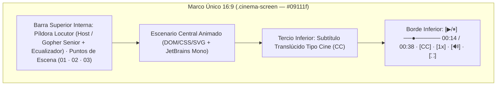

# GoPixel Academy — Propuesta y Arquitectura Senior V9: `Gopher Pixel Cinema` & Audio Neuronal de Estudio

**Estado:** Propuesta arquitectónica lista para implementación (`v9.0`)  
**Alineación Vigilio:** `ux-interactive-cinema` (`v0.8.0`) + `pixel-senior-ux` + `devsecops-static-site`  
**Objetivo:** Incorporar videos interactivos minimalistas de cuadro único (`16:9`) con pizarras técnicas animadas en HTML/CSS/SVG y locución neuronal conversacional a 2 voces masterizada en estudio, manteniendo **0 llamadas a IA en runtime**, **0 archivos `.mp4` pesados** y **100% compatibilidad con GitHub Pages**.

---

## 1. Diagnóstico Senior/Staff: ¿Por qué este enfoque es ideal para `gopixel-academy`?

En una SPA 100% estática alojada en GitHub Pages (con gate estricto en CI `! find dist -type f -size +20M`), grabar videos `.mp4` tradicionales para cada módulo es un anti-patrón grave:
- **65 videos `.mp4`** a `25 MB` cada uno sumarían **`~1.6 GB`**, rompiendo los límites de GitHub Pages (`1 GB`), degradando el clonado Git y viéndose borrosos al hacer zoom o abrir en móvil.
- Usar `window.speechSynthesis` directo del navegador suena robótico y lee código Go (`func (s *Server)`, `:=`, `<-ctx.Done()`, `%w`) de forma ininteligible.

Adoptando la arquitectura **`ux-interactive-cinema`** (probada empíricamente en el ecosistema Vigilio con un promedio real de **`340 KB` por cápsula masterizada**), obtenemos:
1. **Nitidez vectorial infinita (`0 MB` de video rasterizado):** Las animaciones son componentes DOM/CSS/SVG que reutilizan nuestra fuente auto-alojada **`JetBrains Mono`** y nuestro resaltador [`GoCode.tsx`](../../src/components/GoCode.tsx).
2. **Audio estilo Podcast Técnico / NotebookLM (`~340 KB` por clase):** Dos voces neuronales contrastadas (`Host` + `Gopher Senior Architect`) procesadas con diccionario fonético Go y masterizadas con `ffmpeg` (`80 kbps`, `24 kHz` estéreo).
3. **Descarga perezosa (`0 KB` al abrir la web):** `<audio preload="metadata">` solo descarga los `~340 KB` cuando el estudiante pulsa `▶ Play`.

---

## 2. ¿Cuántos videos podemos crear? (3 Fases y Presupuesto Exacto)

El repositorio cuenta hoy con **65 unidades educativas reales**:
- `1` Portada (`Home`)
- `1` Resumen ejecutivo de `Senior Mode` + `1` Proyecto `Capstone`
- `18` Módulos de `Senior Mode` (`S01` a `S18` — 90 Quality Gates)
- `36` Lecciones interactivas (`B01–B12`, `I01–I12`, `A01–A12`)
- `8` Rutas de `Frameworks Academy` (`F01–F08`)

### Tabla comparativa de alcance y peso en repositorio

| Fase Recomendada | Cobertura de Videos (`GopherPlayer`) | Videos con Audio Estudio HD (`.mp3`) | Duración Media | Peso Total en Git / Pages | Recomendación |
|---|---|---:|---:|---:|---|
| **Fase 1 — Senior Mode Completo + Anclas (RECOMENDADA)** | `Home` (1) + `Senior Intro` (1) + **`S01–S18` completos (18)** + `Capstone` (1) + Anclas `B01, I01, A01` (3) *(+ pizarras visuales automáticas en las otras 41 vistas)* | **24 videos HD** | `32–42 s` | **~8.1 MB** (`~340 KB` c/u) | **Mejor retorno inmediato (ROI máximo, build rápido, Senior Mode 100% cubierto)** |
| **Fase 2 — Senior + 36 Clases de Go** | Los 21 videos de Senior/Portada + las **36 clases `B01–A12`** con guion y audio individual a 2 voces | **57 videos HD** | `28–40 s` | **~19.3 MB** | Excelente segunda iteración para cubrir toda la ruta *Aprende Go* |
| **Fase 3 — Plataforma Total 100%** | Los 57 anteriores + las **8 rutas de Frameworks `F01–F08`** (`net/http`, `Gin`, `Chi`, `Echo`, `Fiber`, `SQL`, `gRPC`, `Hexagonal`) | **65 videos HD** | `28–42 s` | **~22.0 MB** | Cobertura absoluta del 100% del catálogo sin superar siquiera 25 MB |

> **Veredicto Senior:** Incluso creando los **65 videos completos con audio de estudio**, el peso total (`~22 MB`) cabe holgadamente en GitHub Pages. Sin embargo, la mejor práctica de ingeniería es ejecutar primero la **Fase 1 (los 24 videos clave centrados al 100% en Senior Mode `S01–S18`)**, validar ritmo, voces y retención en móvil/desktop, y luego expandir por lotes a Fase 2 y Fase 3 con el mismo pipeline automatizado.

---

## 3. Cómo se verá: Regla de Cuadro Único Minimalista («Solo darle Play»)

Siguiendo estrictamente el diseño limpio V3 que acabamos de aplicar en `Senior Mode`, **está prohibido rodear el video con paneles sueltos, transcripciones externas o botoneras apiladas**:



### Estados del reproductor `GopherPlayer.tsx`
1. **Estado `idle` (Póster limpio):**
   - Fondo oscuro `#09111f` con previsualización sutilmente desenfocada de la pizarra Go del módulo, insignia superior discreta (`BRIEFING S07 · 00:38`), título conciso y **un único botón circular central coral/cian `▶`**.
2. **Estado `playing | paused` (Todo dentro del cuadro `16:9`):**
   - Arriba izquierda: avatar pixel Gopher (`senior.png` o `question.png`) + nombre de voz activa (`Host` / `Gopher Senior`) con barras de ecualizador animadas.
   - Centro: una de las **5 pizarras semánticas de ingeniería Go** sincronizada al milisegundo con los `cues[]` del audio.
   - Abajo: subtítulo limpio en `DM Sans` + barra delgada con *scrubber* operable por teclado (`ArrowLeft` / `ArrowRight`) y `<track kind="captions" default>` (`WebVTT`).
3. **Estado `ended`:**
   - Superposición limpia dentro del mismo marco con `[↺ Volver a ver]` y botón directo al primer gate (`Ir a Gate 1 · Decision Lab →`).

---

## 4. Las 5 Pizarras Visuales Especializadas en Ingeniería Go (`StageCanvas`)

A diferencia de Rust (centrado en *borrow checker* y *lifetimes*), Go tiene sus propios modelos mentales de producción. Diseñaremos **5 tableros vectoriales reutilizables** adaptados al runtime de Go:

| Pizarra (`StageVisual.kind`) | Qué anima en pantalla | Módulos Senior donde brilla |
|---|---|---|
| `slice-escape` | **Slice Header (`{ptr, len, cap}`) + Heap & Escape Analysis:** muestra cómo una sub-slice retiene un array gigante en el Heap y cómo `copy()` libera al Garbage Collector. | `S04`, `S07`, `S14` |
| `goroutine-channels` | **Scheduler & Canales Go:** carriles animados de goroutines, canales con buffer acotado, `select`, cancelación por `ctx.Done()`, `sync.Mutex` vs `sync/atomic`. | `S05`, `S06`, `S09`, `S15` |
| `architecture-sre` | **Topología Backend & Resiliencia:** nodos `HTTP Handler → Worker Pool → Redis/Postgres` pasando de estado `incident (P99 1.4s ⚠)` a `mitigated (P99 18ms ✓)`. | `S03`, `S10`, `S11`, `S13`, `S16`, `S17`, `S18` |
| `code-diff` | **Refactor & Code Review Idiomático Go:** comparativa antes/después con nuestro resaltador `GoCode` (`%v` vs `%w` para `errors.Is`, interfaces pequeñas en el consumidor). | `S01`, `S02`, `S08`, `S12` |
| `terminal-race` | **Evidencia Real en Consola Go:** ejecución animada de `go test -race ./...`, trazas `WARNING: DATA RACE`, `pprof top` y `benchstat` con 0 allocs/op. | Transversal en cierres de `S01–S18` y `Capstone` |

---

## 5. Catálogo Detallado de los 24 Videos de la Fase 1 (Senior Mode Completo)

Cada cápsula dura entre **`32` y `42` segundos**, dividida en **3 escenas** (`01 · Incidente / Síntoma` con `Host` → `02 · Mecanismo Interno Go` con `Gopher Senior` → `03 · Solución y Verificación con go test` con `Gopher Senior`):

| # | ID Deck | Ubicación en la SPA | Título de la Cápsula | Pizarra Principal | Duración Est. |
|---:|---|---|---|---|---:|
| 01 | `HOME-INTRO` | `#/` (Portada) | De tu primer `fmt.Println` a Ingeniero Go Senior | `architecture-sre` + `goroutine-channels` | `40 s` |
| 02 | `SENIOR-OVERVIEW` | `#/senior` | Cómo entrenar criterio de producción en los 90 Quality Gates | `architecture-sre` + `terminal-race` | `36 s` |
| 03 | `SENIOR-S01` | `#/senior/S01` | Interfaces pequeñas en el consumidor y cadena de errores `%w` | `code-diff` | `36 s` |
| 04 | `SENIOR-S02` | `#/senior/S02` | Arquitectura modular y hexagonal sin sobre-ingeniería | `architecture-sre` | `36 s` |
| 05 | `SENIOR-S03` | `#/senior/S03` | APIs de pago idempotentes y ventana de expiración TTL | `architecture-sre` | `38 s` |
| 06 | `SENIOR-S04` | `#/senior/S04` | Invariantes de dominio bajo peticiones simultáneas | `goroutine-channels` | `36 s` |
| 07 | `SENIOR-S05` | `#/senior/S05` | Worker Pools acotados, fugas de goroutines y `ctx.Done()` | `goroutine-channels` | `40 s` |
| 08 | `SENIOR-S06` | `#/senior/S06` | Go Memory Model, carreras lógicas y `sync/atomic` | `goroutine-channels` + `terminal-race` | `38 s` |
| 09 | `SENIOR-S07` | `#/senior/S07` | Fugas silenciosas por retención de *backing array* en slices | `slice-escape` | `38 s` |
| 10 | `SENIOR-S08` | `#/senior/S08` | Ingeniería de rendimiento con `pprof` y `benchstat` | `terminal-race` + `code-diff` | `36 s` |
| 11 | `SENIOR-S09` | `#/senior/S09` | Entrega *at-least-once*, deduplicación y consumidores idempotentes | `architecture-sre` | `38 s` |
| 12 | `SENIOR-S10` | `#/senior/S10` | Consistencia de inventario y prevención de sobreventa concurrente | `goroutine-channels` | `38 s` |
| 13 | `SENIOR-S11` | `#/senior/S11` | Tormentas de reintentos (*Retry Storms*), *backoff* y presupuesto | `architecture-sre` | `38 s` |
| 14 | `SENIOR-S12` | `#/senior/S12` | Seguridad backend Go: timeouts HTTP, SQL parametrizado y límites | `code-diff` | `36 s` |
| 15 | `SENIOR-S13` | `#/senior/S13` | Observabilidad accionable: logs estructurados `slog`, métricas y trazas | `terminal-race` | `36 s` |
| 16 | `SENIOR-S14` | `#/senior/S14` | Presión de asignaciones en el GC y latencia de cola P99 | `slice-escape` | `38 s` |
| 17 | `SENIOR-S15` | `#/senior/S15` | Despliegue Zero-Downtime y drenado limpio con `Server.Shutdown` | `goroutine-channels` | `38 s` |
| 18 | `SENIOR-S16` | `#/senior/S16` | Estrategias de caché, *stampede* y `singleflight` en Go | `architecture-sre` | `38 s` |
| 19 | `SENIOR-S17` | `#/senior/S17` | Respuesta a incidentes SRE: triaje, mitigación y postmortem sin culpa | `terminal-race` | `36 s` |
| 20 | `SENIOR-S18` | `#/senior/S18` | Diseño de capacidad, colas acotadas y *backpressure* | `architecture-sre` | `40 s` |
| 21 | `SENIOR-CAPSTONE` | `#/senior/capstone` | Recorrido arquitectónico del Capstone de Órdenes + Outbox en Go | `architecture-sre` + `terminal-race` | `42 s` |
| 22 | `LESSON-B01` | `#/lesson/B01` | Anatomía de `package main`, `import` y tu primer programa Go | `code-diff` | `30 s` |
| 23 | `LESSON-I01` | `#/lesson/I01` | Interfaces implícitas en Go: desacoplamiento sin `implements` | `code-diff` | `32 s` |
| 24 | `LESSON-A01` | `#/lesson/A01` | Tu primera goroutine y comunicación segura por canales | `goroutine-channels` | `34 s` |

---

## 6. Pipeline de Audio Neuronal + Fonética Go (`generate-cinema-audio.py`)

### 6.1 Sanitizador fonético específico para Go (`clean_for_speech_go`)
Antes de enviar cada línea al motor neuronal (`edge-tts`), el script transforma símbolos de código Go en prosodia hablada natural mientras el subtítulo `WebVTT` conserva el código intacto:

| Texto en Subtítulo / Pantalla | Texto enviado al Motor Neuronal TTS |
|---|---|
| `fmt.Println("Hola")` | `"efe eme te punto Print line"` |
| `fmt.Errorf("load: %w", err)` | `"efe eme te punto Error efe con verbo por ciento doble ve"` |
| `ctx, cancel := context.WithTimeout(...)` | `"context con With Timeout y función cancel"` |
| `<-ctx.Done()` | `"recibir del canal context punto Done"` |
| `go test -race ./...` | `"go test guion race en todos los paquetes"` |
| `[]byte` / `map[string]any` | `"slice de bytes"` / `"mapa de string a any"` |
| `P99` / `GOGC` / `ADR` | `"percentil noventa y nueve"` / `"go ge ce"` / `"a de erre"` |

### 6.2 Cadena DSP de Estudio con `ffmpeg`
```text
1. Síntesis por turno:
   - Host: es-CO-SalomeNeural
   - Gopher Senior: es-ES-AlvaroNeural
2. Limpieza de silencios muertos + respiración humana natural (280 ms):
   silenceremove=start_periods=1:start_threshold=-42dB:stop_periods=-1:stop_duration=0.22:stop_threshold=-42dB,apad=pad_dur=0.28
3. Colchón armónico estéreo 24 kHz (acordes cálidos D-minor9 / F-maj7 con swell inicial de 0.45s, ducking bajo la voz y chime sutil en cada cambio de escena cue[]).
4. Mastering final a MP3 80 kbps (~340 KB por video):
   [0:a]highpass=f=85,acompressor=threshold=-18dB:ratio=2.6:attack=10:release=140:makeup=3dB[v];
   [v][1:a]amix=inputs=2:duration=longest:normalize=0:weights='1.0 0.62',alimiter=limit=0.95[out]
5. Exportación automática de src/features/cinema/audio-manifest.json con totalSec, cues[] y speakers[] medidos al milisegundo.
```

---

## 7. Estructura de Archivos y Skills a incorporar en `gopixel-academy`

```text
gopixel-academy/
├── .agents/skills/
│   ├── vigilio/ux-interactive-cinema/
│   │   ├── SKILL.md                       # Skill transversal Vigilio v0.8.0
│   │   └── references/execution.md        # Matriz QA adversaria y checklist WCAG 2.2 AA
│   └── gopher-pixel-cinema/
│       └── SKILL.md                       # Skill de dominio GoPixel (gobierna GopherPlayer y audios)
├── public/audio/
│   ├── home-intro.mp3                     # ~350 KB c/u · cargados solo al pulsar Play
│   ├── senior-overview.mp3
│   ├── senior-s01.mp3 ... senior-s18.mp3
│   ├── senior-capstone.mp3
│   └── lesson-b01.mp3, lesson-i01.mp3, lesson-a01.mp3
├── scripts/
│   └── generate-cinema-audio.py           # Generador reproducible TTS 2 voces + mastering DSP ffmpeg
├── src/features/cinema/
│   ├── cinema.types.ts                    # Contratos CinemaDeck, CinemaScene, StageVisual, StudioAudioMeta
│   ├── audio-manifest.json                # Duraciones reales post-ffmpeg y marcas cues[]
│   ├── audio.ts                           # Resolución de pistas HD + fallback limpio
│   ├── storyboards.ts                     # Guiones curados S01–S18 + generador determinista 54 módulos
│   └── GopherPlayer.tsx                   # Reproductor minimalista 16:9 con 5 pizarras Go + WebVTT + reloj dual
└── tests/
    └── gopher-cinema.test.mjs             # Gate unitario: verifica MP3 existentes, cues.length === scenes.length y WebVTT
```

---

## 8. Gates de Calidad Obligatorios antes de Publicar

1. **Integridad de Manifiesto (`tests/gopher-cinema.test.mjs`):** Cada `deck` con audio tiene su `.mp3` físico en `public/audio/`, `totalSec > 0` y `cues.length === scenes.length`.
2. **Accesibilidad WCAG 2.2 AA:** `<track kind="captions" default>` (`WebVTT`), botón `CC` con `aria-pressed`, barra de progreso con `role="slider"` navegable por teclado y respeto total a `data-reduced-motion="true"`.
3. **Reloj Dual Resiliente para CI Headless:** Si el navegador E2E no tiene tarjeta de sonido o bloquea `audio.play()`, `GopherPlayer` conmuta en `600 ms` a un reloj determinista interno para nunca congelar la reproducción ni fallar tests automatizados.
4. **Presupuesto DevSecOps:** `0` peticiones a APIs externas en runtime, `0` secretos, ningún archivo individual `> 500 KB` y build limpio en GitHub Actions.
